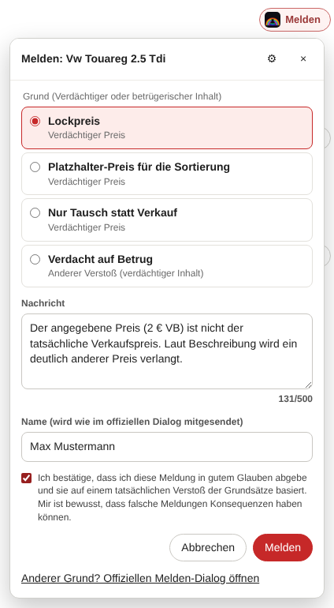
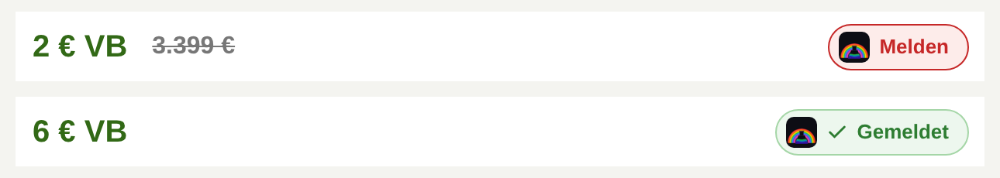

# 🚩 Kleinanzeigen – Anzeige melden

**Unsaubere Anzeigen direkt aus der Suchergebnis-Übersicht melden, mit einem Klick und ohne die Liste zu verlassen.**

*Chrome · Firefox · Edge · Kein Server · Kein Tracking · Meldet wie der offizielle Dialog*

---

Wer auf Kleinanzeigen nach Autos, Elektronik oder Wohnungen sucht, kennt das: **„2 € VB“**, **„6 € VB“**, **„15 € VB“**, und im Text steht dann ein ganz anderer Preis, „Tausch möglich“ oder „Preis ist nicht der Preis“. Solche Lockpreis-Anzeigen schieben sich nach oben, verfälschen die Sortierung nach Preis und kosten allen Zeit.

Melden kann man sie, aber dafür muss man jede Anzeige öffnen, nach unten scrollen, „Anzeige melden“ suchen und danach zurück zur Liste. Dabei geht oft die Scroll-Position verloren.

**Dieses Userscript setzt einen „Melden“-Button direkt neben den Preis jeder Anzeige in der Übersicht.** Ein Klick öffnet ein kleines Menü direkt am Button. Dort wählst du einen **Baustein** (Grund und fertiger Text), passt den Text bei Bedarf an, bestätigst und meldest. Es öffnet sich kein Fenster, und deine Suchergebnisse bleiben unverändert offen. Für alle anderen Gründe öffnet ein Link den **offiziellen Melden-Dialog** in einem kleinen Fenster.

  
   Das Melden-Menü direkt in der Übersicht (Darstellung an einer nachgebauten Seite).

  
   Der Button neben dem Preis: oben „Melden“, unten nach erfolgreicher Meldung „Gemeldet“.

---

## 🔀 Zwei Varianten zur Wahl

Es gibt das Script in zwei Varianten. Beide setzen denselben Button neben den Preis, sie melden nur auf unterschiedlichem Weg.

| | **Bausteine** (`script.user.js`) | **Offizieller Dialog** (`script-offiziell.user.js`) |
|---|---|---|
| Melden | im Menü direkt in der Übersicht, ohne Fenster | im offiziellen Melden-Dialog von Kleinanzeigen, in einem kleinen Popup |
| Grund und Text | fertige, selbst konfigurierbare Bausteine | wählst du jedes Mal im Dialog |
| Anfragen an Kleinanzeigen | sendet die Meldung selbst, genau wie der Dialog | sendet selbst nichts, alles läuft über den Dialog |
| Gründe | direkt: „Verdächtiger oder betrügerischer Inhalt“; alle anderen über den offiziellen Dialog | alle |
| Version | 0.4.1 | 0.3.2 |

**Installiere bitte nur eine der beiden.** Sind doch beide aktiv, arbeitet nur die zuerst gestartete, die andere bleibt still. Die „Gemeldet“-Markierungen teilen sich beide, ein Wechsel geht also nichts verloren.

---

## ✨ Features (Variante Bausteine)

* 🚩 **Melden-Button in der Übersicht:** Er sitzt in jeder Anzeigen-Karte rechts neben dem Preis, trägt das RainbowlabsInc-Logo und fügt sich ins Kleinanzeigen-Design ein.
* 🧩 **Melden ohne Fenster:** Ein Klick öffnet ein Menü am Button. Baustein wählen, Text prüfen, bestätigen, melden. Fertig.
* ✏️ **Eigene Bausteine:** Über ⚙️ im Menü legst du Bausteine an, benennst sie um, sortierst oder löschst sie. Jeder Baustein besteht aus einem offiziellen Grund und einem Text mit Platzhaltern wie `{preis}` oder `{titel}`. Vier fertige Vorlagen sind dabei, z. B. „Lockpreis“.
* ☑️ **Eine Meldung pro Klick:** Jede Meldung muss einzeln bestätigt werden, mit demselben Satz wie im offiziellen Dialog. Mehrere Anzeigen auf einmal zu melden ist bewusst nicht möglich.
* 🪟 **Offizieller Dialog als Rückfall:** Für alle anderen Gründe öffnet ein Link den Melden-Dialog von Kleinanzeigen in einem kleinen Popup. Das Script klickt dort automatisch auf „Anzeige melden“, und nach dem Absenden schließt sich das Fenster wieder.
* 📌 **Übersicht bleibt, wo sie ist:** Kein Seitenwechsel, kein Zurück-Button. Scroll-Position, Filter und Seite bleiben erhalten.
* ✅ **„Gemeldet“-Markierung:** Nach dem Absenden wird der Button grün und bleibt lokal in deinem Browser gespeichert. So meldest du nichts doppelt.
* 🛡️ **Gleicher Weg wie der Dialog:** Das Script sendet nur die Meldung selbst, und zwar genau so, wie der offizielle Dialog sie sendet. Andere Anfragen an Kleinanzeigen stellt es nicht.
* 🔒 **Strikt begrenzt:** Es läuft nur auf `https://www.kleinanzeigen.de` und dort nur auf Such- und Anzeigenseiten.

---

## ⚙️ Installation

**Schritt 1: Userscript-Erweiterung installieren** (kostenlos)

| Browser | Erweiterung |
|---|---|
| Chrome / Edge | [Tampermonkey](https://chrome.google.com/webstore/detail/tampermonkey/dhdgffkkebhmkfjojejmpbldmpobfkfo) oder [Violentmonkey](https://chrome.google.com/webstore/detail/violentmonkey/jinjaccalgkegednnccohejagnlnfdag) |
| Firefox | [Tampermonkey](https://addons.mozilla.org/de/firefox/addon/tampermonkey/) oder [Violentmonkey](https://addons.mozilla.org/de/firefox/addon/violentmonkey/) |

> **Chrome/Edge:** Bei neueren Tampermonkey-Versionen muss in den Erweiterungs-Details „Benutzerskripte zulassen“ bzw. der Entwicklermodus aktiviert sein.

**Schritt 2: Eine Variante installieren**

&nbsp;

*(Alternativ: Inhalt von `script.user.js` bzw. `script-offiziell.user.js` kopieren und in Tampermonkey als neues Skript einfügen.)*

**Wechseln:** In Tampermonkey die bisherige Variante deaktivieren oder löschen, dann die andere installieren.

Updates holt sich Tampermonkey für jede Variante automatisch aus diesem Repo.

---

## 🛠️ Bedienung

1. Auf Kleinanzeigen.de **einloggen**, denn Melden setzt ein Konto voraus.
2. Ganz normal suchen, z. B. in der Kategorie Autos.
3. Bei einer unsauberen Anzeige rechts neben dem Preis auf **„Melden“** klicken.
4. Im Menü einen Baustein wählen und den Text bei Bedarf anpassen.
5. Die Bestätigung anhaken und auf **„Melden“** klicken. Der Button zeigt danach **„Gemeldet“**.

**Bausteine anpassen:** Im Menü auf ⚙️ klicken. Im Text kannst du diese Platzhalter verwenden:

| Platzhalter | wird ersetzt durch |
|---|---|
| `{titel}` | Titel der Anzeige |
| `{preis}` | angezeigter Preis, z. B. „2 € VB“ |
| `{id}` | Anzeigen-Nummer |
| `{link}` | Link zur Anzeige |

Direkt aus dem Menü lassen sich bisher die Unterpunkte von **„Verdächtiger oder betrügerischer Inhalt“** melden: Verdächtiger Preis, Identitätsdiebstahl/-missbrauch, Verdächtiges Verhalten und Anderer Verstoß. Alle anderen Gründe gehen über **„Anderer Grund? Offiziellen Melden-Dialog öffnen“**.

**Variante „Offizieller Dialog“:** Nach dem Klick auf „Melden“ öffnet sich gleich das kleine Fenster mit dem Melden-Dialog von Kleinanzeigen. Dort wählst du den Grund und schickst ab. Das Fenster schließt sich danach von selbst.

> Falls der Browser das Fenster für den offiziellen Dialog blockiert, erscheint unten ein Hinweis. Erlaube dann Popups für `kleinanzeigen.de`, oder öffne die Anzeige über den Hinweis in einem neuen Tab.

---

## 🔧 Wie es technisch funktioniert

| Seite | Was passiert |
|---|---|
| Suchergebnisse (`/s-…`) | Das Script erkennt die Anzeigen-Karten über ihre Links auf `/s-anzeige/…` und setzt den Button in die Preiszeile. Nachgeladene Ergebnisse werden per `MutationObserver` ebenfalls erfasst. |
| Klick auf „Melden“ | Das Menü öffnet sich. Im Hintergrund lädt das Script die Anzeigenseite, wie beim normalen Öffnen, und liest dort den Sicherheits-Token und deinen Namen aus. Das sind dieselben Werte, die der offizielle Dialog verwendet. |
| Absenden | `POST /flags/ads/<Anzeigen-Nr>.json` mit Grund, Text und Name, dazu der Token als `x-csrf-token`. Genau diese Anfrage schickt auch der offizielle Dialog. |
| „Offiziellen Melden-Dialog öffnen“ | Die Anzeige wird mit dem Hash `#klm-report` in einem Popup-Fenster geöffnet. Dasselbe Script erkennt den Hash, klickt auf „Anzeige melden“, hebt den Dialog hervor und meldet den Status per `postMessage` an die Übersicht zurück. |

> **Warum ist der offizielle Dialog ein eigenes Fenster und kein Overlay?** Kleinanzeigen verbietet das Einbetten seiner Seiten in andere Seiten (Schutz gegen Clickjacking). Ein eingebettetes Fenster wird vom Browser blockiert.

Alle Selektoren, Texte, Gründe und Standard-Bausteine stehen gesammelt im `CONFIG`-Block am Anfang von `script.user.js`.

---

## 🧪 Getestet

| Browser | Erweiterung | Stand |
|---|---|---|
| Firefox | Tampermonkey | ✅ auf der Live-Seite getestet: Button, Melde-Popup, automatisches Schließen (bis 0.3.1, entspricht der Variante „Offizieller Dialog“) |
| Firefox | Tampermonkey | ⏳ Melden-Menü der Variante „Bausteine“ (ab 0.4.0) bisher nur an einer nachgebauten Seite getestet. Das Anfrageformat stammt aus einer echten Meldung über den offiziellen Dialog. |
| Chrome / Edge | Tampermonkey / Violentmonkey | ⏳ noch nicht getestet, sollte genauso funktionieren |

Kleinanzeigen ändert sein Frontend regelmäßig. Das Script sucht Buttons und Dialoge deshalb zuerst über feste Merkmale (z. B. `#viewad-action-flag-link`) und nutzt als Rückfall die Beschriftung. Funktioniert trotzdem etwas nicht mehr, hilft ein [Issue](https://github.com/RainbowLabsInc/Kleinanzeigen.de_Anzeige_melden/issues) mit:

1. einem Screenshot und der Meldung aus der Statusleiste unten in der Übersicht,
2. dem HTML des betroffenen Elements (DevTools → Element → Rechtsklick → *Copy → Copy outerHTML*).

Bitte **keine** Cookies, Tokens oder persönlichen Daten mitschicken.

---

## 📋 Versionen

| Version | Änderungen |
|---|---|
| **0.4.1** | Zweite Variante „Offizieller Dialog“ (`script-offiziell.user.js`, 0.3.2) zur freien Wahl; sind beide installiert, bleibt eine inaktiv |
| **0.4.0** | Melden direkt in der Übersicht über ein Menü mit selbst konfigurierbaren Bausteinen; offizieller Dialog bleibt als Rückfall |
| **0.3.1** | Aufgeräumt: Kommentare, Benennung und Kleinigkeiten im Code, „Gemeldet“-Button erneut anklickbar |
| **0.3.0** | RainbowlabsInc-Logo im Melden-Button und als Script-Icon in Tampermonkey |
| **0.2.2** | Melde-Fenster schließt sich nach dem Absenden bzw. Abbrechen automatisch |
| **0.2.1** | „Anzeige melden“ wird im Fenster zuverlässig automatisch ausgelöst |
| **0.2.0** | Melden über ein kleines Popup-Fenster, Statusleiste in der Übersicht |
| **0.1.x** | Erste Version: Melden-Button neben dem Preis, Begrenzung auf kleinanzeigen.de |

---

## 🗺️ Ideen für später

* Weitere Gründe (z. B. „Mutmaßlich gewerblicher Anbieter“) direkt aus dem Menü melden, sobald ihre Unterpunkte bekannt sind.
* Optionale Hervorhebung verdächtiger Anzeigen (z. B. 1–15 € bei Autos).
* Browser-Extension (Chrome/Edge/Firefox) auf Basis desselben Codes.

---

## ⚖️ Disclaimer

> Dieses Skript ist ein inoffizielles Tool und steht in keiner Verbindung zu Kleinanzeigen. Die Nutzung erfolgt auf eigene Gefahr. Bitte melde nur Anzeigen, die tatsächlich gegen die Regeln verstoßen. Missbräuchliche Massenmeldungen können zur Sperrung deines Kontos führen.

* Es liest keine Passwörter oder Nachrichten aus.
* Es nutzt keine externen Server, alles läuft lokal in deinem Browser. Das Logo im Button ist direkt im Script eingebettet.
* An Kleinanzeigen schickt es nur das, was auch beim normalen Melden passiert: die Anzeigenseite laden und die Meldung absenden, und zwar erst nach deinem Klick und deiner Bestätigung.
* Bausteine, „Gemeldet“-Markierungen und dein zuletzt verwendeter Name liegen nur im Speicher deines Browsers für kleinanzeigen.de.
* Es läuft **ausschließlich auf `https://www.kleinanzeigen.de`**, und dort nur auf Such- und Anzeigenseiten (`/s-…`). Auf allen anderen Websites ist es inaktiv.
* Inspiriert vom Aufbau des Userscripts [Kleinanzeigen.de – Anzeige duplizieren & neu einstellen](https://github.com/Zer089/Kleinanzeigen.de-Anzeige_duplizieren_neu_einstellen) von Zer089 (MIT).

---

## ☕ Unterstütze das Projekt

Dieses Userscript ist ein kostenloses Open-Source-Hobbyprojekt. Wenn es dir Zeit und Nerven bei der Suche auf Kleinanzeigen spart, freue ich mich über einen Kaffee. Jeder Beitrag fließt direkt in die Weiterentwicklung dieses und weiterer Projekte.

---

## 📄 Lizenz

MIT License: frei nutzbar, veränderbar und weitergebbar. Siehe [LICENSE](LICENSE).

---

**Made with ❤️ by RainbowlabsInc**

[Installieren: Bausteine](https://github.com/RainbowLabsInc/Kleinanzeigen.de_Anzeige_melden/raw/main/script.user.js) · [Installieren: Offizieller Dialog](https://github.com/RainbowLabsInc/Kleinanzeigen.de_Anzeige_melden/raw/main/script-offiziell.user.js) · [Issues](https://github.com/RainbowLabsInc/Kleinanzeigen.de_Anzeige_melden/issues) · [☕ Spenden](https://ko-fi.com/rainbowlabsinc)

